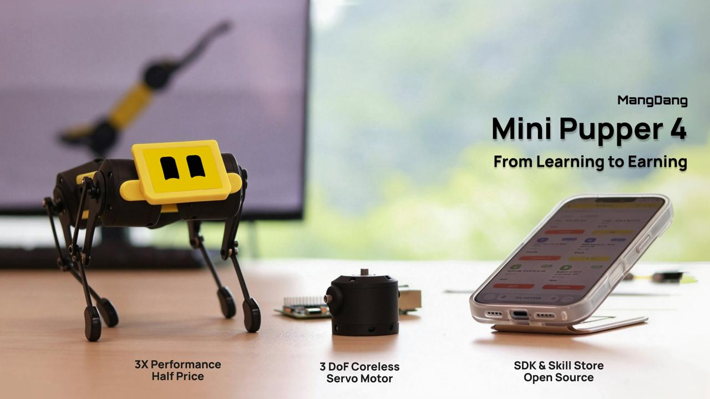
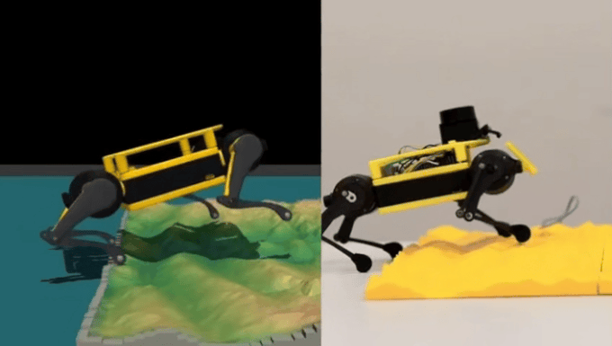
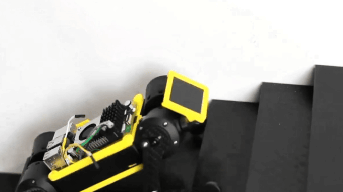
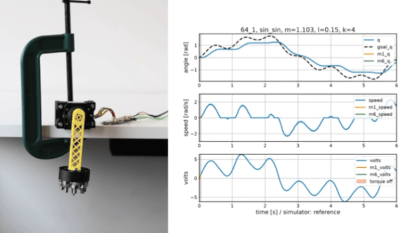
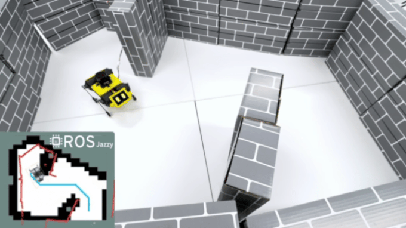
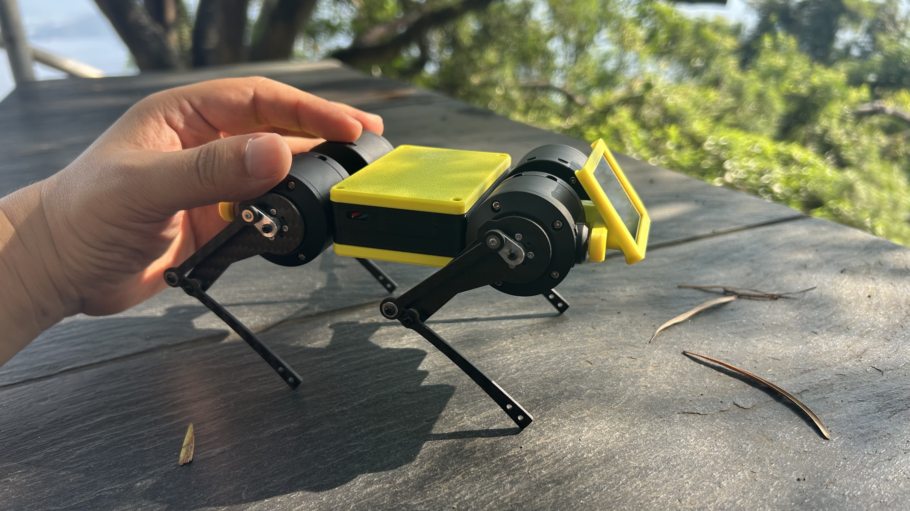

  

<h1 align="center">Mini Pupper 4</h1>

  <em>From Learning to Earning — Powered by 3-DoF Coreless Smart Servos.</em>

  <a href="https://mangdang.org"><b>Official Website</b></a> ·
  <a href="https://www.facebook.com/groups/519009562699751">Facebook Group</a> ·
  <a href="https://discord.gg/xJdt3dHBVw">Discord Community</a> ·
  <a href="https://mangdang.store/collections/shop">Online Shop</a> ·
  <a href="CONTRIBUTING.md">Contributing Guide</a>

---

## Capabilities & Frameworks

<table>
<tr>
<td width="50%">
  
</td>
<td width="50%">
  
</td>
</tr>
  
<tr>
<td><b>Close the Sim2Real Gap: </b> Train complex neural network policies flawlessly in high-fidelity simulation, and deploy straight to the real physical robot.</td>
<td><b>Adapt to Diverse Terrains: </b> Powered by proprietary 3-DoF coreless actuators, Mini Pupper 4 effortlessly climbs stairs and clear complex obstacles.</td>
</tr>

<tr>
<td width="50%">
  
</td>
<td width="50%">
  
</td>
</tr>

<tr>
<td><b>Native BAM Integration: </b> Fully compatible with Better Actuator Models (BAM) to capture precise joint friction physics, letting you focus on your advanced applications.</td>
<td><b>Advanced ROS 2 Stack: </b> Out-of-the-box templates featuring ROS 2 Jazzy and micro-ROS for SLAM, Nav2 path planning, and rapid development.</td>
</tr>
</table>

  

All capabilities stem from our proprietary high-performance, **3-DoF coreless smart servo joints** — the ultimate, versatile building block for modern open-source robotics.

  

## Open Source Repo Guide

| Github Repo | Description |
|---|---|
| [🤖 RL ](https://github.com/mangdangroboticsclub/mini_pupper_4_sim) | The physics engine backend: MuJoCo and NVIDIA Isaac environments, PPO pipelines, domain randomization, and the baked-in ONNX export runtime. |
| [⚙️ BAM Friction Engine](https://github.com/mangdangroboticsclub/bam) | Hardware actuator physics repository. The MangDang MD-300C-150 servo is fully benchmarked and adapted to BAM. |
| [🛹 ROS 2 Core Stack](https://github.com/mangdangroboticsclub/mini_pupper_ros) | ROS software platform. We follow the official Open Robotics roadmap with stable support up to ROS 2 Jazzy and Lyrical. |
| [📡 micro-ROS Stack](https://github.com/mangdangroboticsclub/mini_pupper_ros) | micro ROS software platform. Real-time lower-level agent bridging. |
| [🧠 MCU Brain](https://github.com/mangdangroboticsclub/minipupper-4-mcu) | Complete firmware layer source code for the onboard microcontroller, including embedded local AI routing. |
| [🍓 Raspberry Pi Brain](https://github.com/mangdangroboticsclub/minipupper-4-mcu) | High-level application space source code tailored for the Raspberry Pi computing chassis. |
| [🤝 CONTRIBUTING.md](CONTRIBUTING.md) | Developer guidelines for compiling, local simulation testing, layout conventions, and code submission rules. |
| [📖 Online Manual](https://minipupperdocs.readthedocs.io/en/latest/index.html) | Comprehensive documentation hub, including modular mechanical blueprints, PCB schematics, and open research challenges. |
| [mini pupper 1 bsp](https://github.com/mangdangroboticsclub/mini_pupper_bsp) | BSP(board support package) for Mini Pupper 1. |
| [mini pupper 2 bsp](https://github.com/mangdangroboticsclub/mini_pupper_2_bsp) | BSP(board support package) for Mini Pupper 2. |
| [mini pupper web controller](https://minipupperdocs.readthedocs.io/en/latest/index.html) | This code provides a web GUI for Mini Pupper 1&2 running StanfordQuadruped. |

### Contributions

#### Repositories

| Repository                                                                               | Description                                                                                                                                                                      | Status       |
| ---                                                                                      | ---                                                                                                                                                                              | ---          |
| [minipupper_kinematics](https://github.com/hdumcke/minipupper_kinematics)                | This repositories contains Jupyter notebook that used to gain a better understanding of the kinematics of a quadruped robot in general and Mini Pupper 1 in particular. | experimental |
| [mini-pupper-jupyter-notebooks](https://github.com/Tiryoh/mini-pupper-jupyter-notebooks) | ROSCon2022 Jupyter Notebooks for Mini Pupper 1.                                                                                                                                    | experimental |
