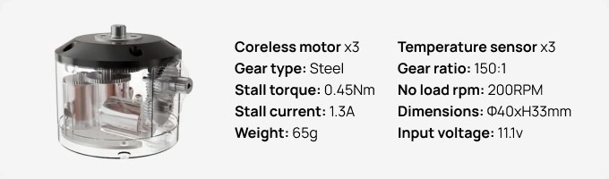
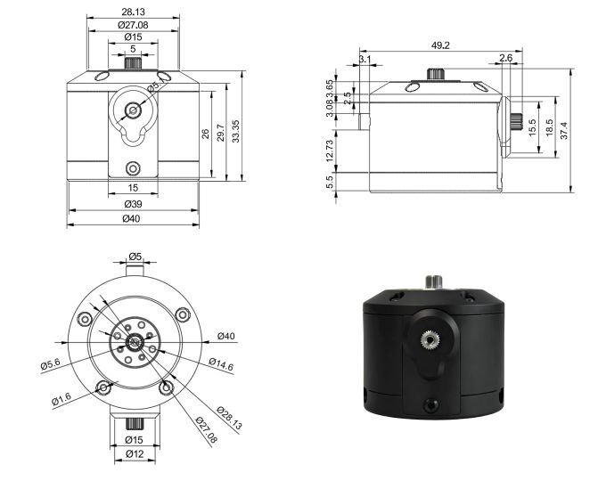

# MD-300-150

> 

## Contents

- [Specifications](#specifications)
  - [Dimensions](#dimensions)
- [Safety Information](#safety-information)
- [Performance Graph](#performance-graph)
- [Control Table](#control-table)
- [Control Table, Data, Address](#control-table-data-address)
  - [Area (EEPROM, RAM)](#area-eeprom-ram)
  - [Size](#size)
  - [Access](#access)
  - [Initial Value](#initial-value)
  - [Control Table of EEPROM Area](#control-table-of-eeprom-area)
  - [Control Table of RAM Area](#control-table-of-ram-area)
  - [Control Table Description](#control-table-description)
- [How to Assemble](#how-to-assemble)
- [Reference](#reference)
  - [What is the Profile](#what-is-the-profile)
  - [Certifications](#certifications)
- [Quick Start](#quick-start)
  - [Prerequisites](#prerequisites)
  - [Compatible Software with MANGDANG](#compatible-software-with-mangdang)
  - [Connector Information](#connector-information)
- [Communication Circuit](#communication-circuit)
  - [TTL Communication (3.3V Logic, 5V Compatible)](#ttl-communication-33v-logic-5v-compatible)
- [Drawings](#drawings)
- [Moment of Inertia](#moment-of-inertia)

## Specifications

| Item                   | Specifications                                                                                                                                                                                         |
| ---------------------- | ------------------------------------------------------------------------------------------------------------------------------------------------------------------------------------------------------ |
| MCU                    | ARM CORTEX-M4F (200 [MHz], 32Bit)                                                                                                                                                                      |
| Position Sensor        | Potentiometer (10Bit, 310 [°])                                                                                                                                                                         |
| Motor                  | Coreless x3                                                                                                                                                                                            |
| Baud Rate              | 9,600 [bps] ~ 4 [Mbps]                                                                                                                                                                                 |
| Control Algorithm      | PID control                                                                                                                                                                                            |
| Resolution             | 4096 [pulse/rev]                                                                                                                                                                                       |
| Operating Modes        | Current Control Mode  Velocity Control Mode  Position Control Mode (0 ~ 310 [°])  Extended Position Control Mode (Multi-turn)   Current-based Position Control Mode  PWM Control Mode (Voltage Control Mode) |
| Weight                 | 65 [g]                                                                                                                                                                                                 |
| Dimensions (W x H x D) | **Ø40.0 x 33.3** [mm]                                                                                                                                                                                  |
| Gear Ratio             | 161.9:1 | 155.3:1 | 152.7:1                                                                                                                                                                            |
| Stall Torque           | 0.5 [N.m] (at 9 [V], 0.7 [A], 0.71 [Nm/A])0.6 [N.m] (at 11.1 [V], 0.8 [A], 0.75 [Nm/A])0.7 [N.m] (at 6.0 [V], 0.9 [A], 0.78 [Nm/A])                                                                  |
| No Load Speed          | 99/100/101 [rev/min] (at 7.4 [V])  **150/152/153 [rev/min] (at 11.1 [V])**  206/209/209 [rev/min] (at 14.8 [V])                                                                                          |
| Operating Temperature  | -5 ~ +70 [°C]                                                                                                                                                                                          |
| Input Voltage          | 9.0 ~ 12.6 [V] (**Recommended : 11.1 [V]**)                                                                                                                                                            |
| Command Signal         | Digital Packet                                                                                                                                                                                         |
| Physical Connection    | SPI TTL : ongoing                                                                                                                                                                                      |
| ID                     | 253 ID (0 ~ 252)                                                                                                                                                                                       |
| Feedback               | Position, Velocity, Current, Realtime tick, Trajectory, Temperature, Input Voltage, etc                                                                                                                |
| Case Material          | Engineering Plastic                                                                                                                                                                                    |
| Gear Material          | Steer & Engineering Plastic                                                                                                                                                                            |
| Standby Current        | 50 [mA]                                                                                                                                                                                                |

### Dimensions

## Safety Information

> [!CAUTION]
> **DANGER.** Ignoring these warnings may cause serious injury or death.
>
> - Never place items containing water, flammables/open flames, or solvents near the product.
> - Never place fingers, arms, toes, and other body parts near product during operation.
> - Cease operation and remove power from the product if the product begins to emit strange odors, noises, or smoke.
> - Keep product out of reach of children.
> - Check input polarity before installing or energizing wiring or cables.

> [!CAUTION]
> Ignoring these warnings may cause mild injury or damage to the product.
>
> - Always comply with the product's offical operating environment specifications including input voltage, current, and operating temperature.
> - The offical MANGDANG controller is recommended to ensure a stable power supply.
> - Do not insert blades or other sharp objects during product operation.

> [!IMPORTANT]
> **ATTENTION.** Ignoring these warnings may cause minor injury or damage to the product.
>
> - Do not disassemble or modify the product.
> - Do not drop the product or apply strong impacts.
> - Do not connect or disconnect cables while power is being supplied.

>

## Performance Graph(T.B.D)

## Control Table

The Control Table is a data structure used by MANGDANG actuators to manage the state of the device. Users can read data registers to get information about the status of the device with Read Instruction Packets, and modify data registers to control the device with Write Instruction Packets.

> [!WARNING]
> The MANGDANG series Control Table configuration may differ depending on the model and firmware. Verify the Address and supported features in the Control Table of the specific model you are using.

## Control Table, Data, Address

The Control Table is a structure that consists of multiple Data fields to store status or to control the device. Users can check current status of the device by reading a specific Data from the Control Table with Read Instruction Packets. WRITE Instruction Packets enable users to control the device by changing specific Data in the Control Table. The Address is a unique value when accessing a specific Data in the Control Table with Instruction Packets. In order to read or write data, users must designate a specific Address in the Instruction Packet. Please refer to [MANGDANG Protocol(will be compatable to popular protecol)](https://docs.robotis.com/docs/dxl/protocol/protocol2) for more details about Instruction Packets.

> [!NOTE]
> Two's complement is applied for the negative value. For more information, please refer to [Two's complement](https://en.wikipedia.org/wiki/Two%27s_complement) from Wikipedia.

### Area (EEPROM, RAM)

The Control Table is divided into 2 Areas. Data in the RAM Area is reset to initial values when the power is reset(Volatile). On the other hand, data in the EEPROM Area is maintained even when the device is powered off(Non-Volatile).

> [!CAUTION]
> Data in the EEPROM Area can only be written to if Torque Enable(64) is cleared to '0' (Torque OFF).

### Size

The Size of data varies from 1 ~ 4 bytes depend on their usage. Please check the size of data when updating the data with an Instruction Packet. For data larger than 2 bytes will be saved according to [Little Endian](https://en.wikipedia.org/wiki/Endianness#Little).

### Access

The Control Table has two different access properties. ‘RW’ property stands for read and write access permission while ‘R’ stands for read only access permission. Data with the read only property cannot be changed by the WRITE Instruction. Read only property(‘R’) is generally used for measuring and monitoring purpose, and read write property(‘RW’) is used for controlling device.

### Initial Value

Each data in the Control Table is restored to initial values when the device is turned on. Default values in the EEPROM area are initial values of the device (factory default settings). If any values in the EEPROM area are modified by a user, modified values will be restored as initial values when the device is turned on. Initial Values in the RAM area are restored when the device is turned on.

### Control Table of EEPROM Area

| Address | Size(Byte) | Data Name                                         | Access | Initial Value | Range                  | Unit            |
| ------- | ---------- | ------------------------------------------------- | ------ | ------------- | ---------------------- | --------------- |
| 0       | 2          | [Model Number](#model-number0)                    | R      | 1,200         | -                      | -               |
| 2       | 4          | Model Information                                 | R      | -             | -                      | -               |
| 6       | 1          | [Firmware Version](#firmware-version6)            | R      | -             | -                      | -               |
| 7       | 1          | [ID](#id7)                                        | RW     | 1             | 0 ~ 252                | -               |
| 8       | 1          | [Baud Rate](#baud-rate8)                          | RW     | 1             | 0 ~ 6                  | -               |
| 9       | 1          | [Return Delay Time](#return-delay-time9)          | RW     | 250           | 0 ~ 254                | 2 [μsec]        |
| 10      | 1          | [Drive Mode](#drive-mode10)                       | RW     | 0             | 0 ~ 13                 | -               |
| 11      | 1          | [Operating Mode](#operating-mode11)               | RW     | 3             | 0 ~ 16                 | -               |
| 12      | 1          | [Secondary(Shadow) ID](#secondaryshadow-id12)     | RW     | 255           | 0 ~ 252                | -               |
| 13      | 1          | [Protocol Type](#protocol-type13)                 | RW     | 2             | 2 ~ 22                 | -               |
| 20      | 4          | [Homing Offset](#homing-offset20)                 | RW     | 0             | -1,044,479 ~ 1,044,479 | 1 [pulse]       |
| 24      | 4          | [Moving Threshold](#moving-threshold24)           | RW     | 10            | 0 ~ 1,023              | 0.229 [rev/min] |
| 31      | 1          | [Temperature Limit](#temperature-limit31)         | RW     | 70            | 0 ~ 100                | 1 [°C]          |
| 32      | 2          | [Max Voltage Limit](#minmax-voltage-limit34-32)   | RW     | 70            | 31 ~ 70                | 0.1 [V]         |
| 34      | 2          | [Min Voltage Limit](#minmax-voltage-limit34-32)   | RW     | 35            | 31 ~ 70                | 0.1 [V]         |
| 36      | 2          | [PWM Limit](#pwm-limit36)                         | RW     | 885           | 0 ~ 885                | 0.113 [%]       |
| 38      | 2          | [Current Limit](#current-limit38)                 | RW     | 1,750         | 0 ~ 1,750              | 1 [mA]          |
| 44      | 4          | [Velocity Limit](#velocity-limit44)               | RW     | 445           | 0 ~ 2,047              | 0.229 [rev/min] |
| 48      | 4          | [Max Position Limit](#minmax-position-limit52-48) | RW     | 4,095         | 0 ~ 4,095              | 1 [pulse]       |
| 52      | 4          | [Min Position Limit](#minmax-position-limit52-48) | RW     | 0             | 0 ~ 4,095              | 1 [pulse]       |
| 60      | 1          | [Startup Configuration](#startup-configuration60) | RW     | 0             | 3                      | -               |
| 62      | 1          | [PWM Slope](#pwm-slope62)                         | RW     | 140           | 1 ~ 255                | 1.977 [mV/msec] |
| 63      | 1          | [Shutdown](#shutdown63)                           | RW     | 53            | -                      | -               |

### Control Table of RAM Area

| Address | Size(Byte) | Data Name                                                                        | Access | Initial Value | Range                                               | Unit                      |
| ------- | ---------- | -------------------------------------------------------------------------------- | ------ | ------------- | --------------------------------------------------- | ------------------------- |
| 64      | 1          | [Torque Enable](#torque-enable64)                                                | RW     | 0             | 0 ~ 1                                               | -                         |
| 65      | 1          | [LED](#led65)                                                                    | RW     | 0             | 0 ~ 1                                               | -                         |
| 68      | 1          | [Status Return Level](#status-return-level68)                                    | RW     | 2             | 0 ~ 2                                               | -                         |
| 69      | 1          | [Registered Instruction](#registered-instruction69)                              | R      | 0             | 0 ~ 1                                               | -                         |
| 70      | 1          | [Hardware Error Status](#hardware-error-status70)                                | R      | 0             | -                                                   | -                         |
| 76      | 2          | [Velocity I Gain](#velocity-pi-gain76-78)                                        | RW     | 1,600         | 0 ~ 16,383                                          | -                         |
| 78      | 2          | [Velocity P Gain](#velocity-pi-gain76-78)                                        | RW     | 180           | 0 ~ 16,383                                          | -                         |
| 80      | 2          | [Position D Gain](#position-pid-gain80-82-84-feedforward-1st2nd-gains88-90)      | RW     | 0             | 0 ~ 16,383                                          | -                         |
| 82      | 2          | [Position I Gain](#position-pid-gain80-82-84-feedforward-1st2nd-gains88-90)      | RW     | 0             | 0 ~ 16,383                                          | -                         |
| 84      | 2          | [Position P Gain](#position-pid-gain80-82-84-feedforward-1st2nd-gains88-90)      | RW     | 400           | 0 ~ 16,383                                          | -                         |
| 88      | 2          | [Feedforward 2nd Gain](#position-pid-gain80-82-84-feedforward-1st2nd-gains88-90) | RW     | 0             | 0 ~ 16,383                                          | -                         |
| 90      | 2          | [Feedforward 1st Gain](#position-pid-gain80-82-84-feedforward-1st2nd-gains88-90) | RW     | 0             | 0 ~ 16,383                                          | -                         |
| 98      | 1          | [Bus Watchdog](#bus-watchdog98)                                                  | RW     | 0             | 1 ~ 127                                             | 20 [msec]                 |
| 100     | 2          | [Goal PWM](#goal-pwm100)                                                         | RW     | -             | -PWM Limit(36) ~ PWM Limit(36)                      | -                         |
| 102     | 2          | [Goal Current](#goal-current102)                                                 | RW     | -             | -Current Limit(38) ~ Current Limit(38)              | 1 [mA]                    |
| 104     | 4          | [Goal Velocity](#goal-velocity104)                                               | RW     | -             | -Velocity Limit(44) ~ Velocity Limit(44)            | 0.229 [rev/min]           |
| 108     | 4          | [Profile Acceleration](#profile-acceleration108)                                 | RW     | 0             | 0 ~ 32,767 (velocity-based) 0 ~ 32,737 (time-based) | 214.577 [rev/min2] 1 [ms] |
| 112     | 4          | [Profile Velocity](#profile-velocity112)                                         | RW     | 0             | 0 ~ 32,767                                          | 0.229 [rev/min]           |
| 116     | 4          | [Goal Position](#goal-position116)                                               | RW     | -             | Min Position Limit(52) ~ Max Position Limit(48)     | 1 [pulse]                 |
| 120     | 2          | [Realtime Tick](#realtime-tick120)                                               | R      | -             | 0 ~ 32,767                                          | 1 [msec]                  |
| 122     | 1          | [Moving](#moving122)                                                             | R      | 0             | 0 ~ 1                                               | -                         |
| 123     | 1          | [Moving Status](#moving-status123)                                               | R      | 0             | -                                                   | -                         |
| 124     | 2          | [Present PWM](#present-pwm124)                                                   | R      | -             | -                                                   | -                         |
| 126     | 2          | [Present Current](#present-current126)                                           | R      | -             | -                                                   | 1 [mA]                    |
| 128     | 4          | [Present Velocity](#present-velocity128)                                         | R      | -             | -                                                   | 0.229 [rev/min]           |
| 132     | 4          | [Present Position](#present-position132)                                         | R      | -             | -                                                   | 1 [pulse]                 |
| 136     | 4          | [Velocity Trajectory](#velocity-trajectory136)                                   | R      | -             | -                                                   | 0.229 [rev/min]           |
| 140     | 4          | [Position Trajectory](#position-trajectory140)                                   | R      | -             | -                                                   | 1 [pulse]                 |
| 144     | 2          | [Present Input Voltage](#present-input-voltage144)                               | R      | -             | -                                                   | 0.1 [V]                   |
| 146     | 1          | [Present Temperature](#present-temperature146)                                   | R      | -             | -                                                   | 1 [°C]                    |
| 147     | 1          | [Backup Ready](#backup-ready147)                                                 | R      | -             | 0 ~ 1                                               | -                         |
| 168     | 2          | [Indirect Address 1](#indirect-address-indirect-data)                            | RW     | 224           | 64 ~ 251                                            | -                         |
| 170     | 2          | [Indirect Address 2](#indirect-address-indirect-data)                            | RW     | 225           | 64 ~ 251                                            | -                         |
| 172     | 2          | [Indirect Address 3](#indirect-address-indirect-data)                            | RW     | 226           | 64 ~ 251                                            | -                         |
| …       | …          | …                                                                                | …      | …             | …                                                   | …                         |
| 218     | 2          | [Indirect Address 26](#indirect-address-indirect-data)                           | RW     | 249           | 64 ~ 251                                            | -                         |
| 220     | 2          | [Indirect Address 27](#indirect-address-indirect-data)                           | RW     | 250           | 64 ~ 251                                            | -                         |
| 222     | 2          | [Indirect Address 28](#indirect-address-indirect-data)                           | RW     | 251           | 64 ~ 251                                            | -                         |
| 224     | 1          | [Indirect Data 1](#indirect-address-indirect-data)                               | RW     | 0             | 0 ~ 255                                             | -                         |
| 225     | 1          | [Indirect Data 2](#indirect-address-indirect-data)                               | RW     | 0             | 0 ~ 255                                             | -                         |
| 226     | 1          | [Indirect Data 3](#indirect-address-indirect-data)                               | RW     | 0             | 0 ~ 255                                             | -                         |
| …       | …          | …                                                                                | …      | …             | …                                                   | …                         |
| 249     | 1          | [Indirect Data 26](#indirect-address-indirect-data)                              | RW     | 0             | 0 ~ 255                                             | -                         |
| 250     | 1          | [Indirect Data 27](#indirect-address-indirect-data)                              | RW     | 0             | 0 ~ 255                                             | -                         |
| 251     | 1          | [Indirect Data 28](#indirect-address-indirect-data)                              | RW     | 0             | 0 ~ 255                                             | -                         |

> [!NOTE]
> Firmware versions prior to V53 support up to 20 Indirect Address/Data items. The address range for Indirect Address is 168 ~ 207, and for Indirect Data is 208 ~ 227.

### Control Table Description

> [!CAUTION]
> Data in the EEPROM Area can only be written when the value of Torque Enable(64) is cleared to ‘0’.

#### Model Number(0)

This address stores model number of MANGDANG.

#### Firmware Version(6)

This address stores firmware version of MANGDANG.

#### ID(7)

The ID is a unique value in the network to identify each MANGDANG with an Instruction Packet.
0 ~ 252 (0xFC) values can be used as an ID, and 254(0xFE) is occupied as a broadcast ID. The Broadcast ID(254, 0xFE) can send an Instruction Packet to all connected MANGDANG simultaneously.

> [!NOTE]
> Please avoid using an identical ID for multiple MANGDANG. You may face communication failure or may not be able to detect MANGDANG with an identical ID.

> [!NOTE]
> If the Instruction Packet ID is set to the Broadcast ID(0xFE), Status Packets will not be returned for READ or WRITE Instructions regardless of the set value of Status Return Level (68). For more details, please refer to the `Status Packet` section for [MANGDANG Protocol 2.0](https://docs.robotis.com/docs/dxl/protocol/protocol2)

#### Baud Rate(8)

The Baud Rate(8) determines serial communication speed between a controller and MANGDANG.

| Value      | Baud Rate     | Margin of Error |
| ---------- | ------------- | --------------- |
| 6          | 4M [bps]      | 0.000 [%]       |
| 5          | 3M [bps]      | 0.000 [%]       |
| 4          | 2M [bps]      | 0.000 [%]       |
| 3          | 1M [bps]      | 0.000 [%]       |
| 2          | 115,200 [bps] | 0.0064 [%]      |
| 1(Default) | 57,600 [bps]  | 0.0016 [%]      |
| 0          | 9,600 [bps]   | 0.000 [%]       |

> [!NOTE]
> Less than 3% of the baud rate error margin will not affect to UART communication.

> [!NOTE]
> For the stable communication with higher Baudrate using U2D2, configure USB Latency value to the lower.
> [USB Latency Setting](https://docs.robotis.com/docs/software/dynamixel_wizard_2_0/advanced_features#usb-latency-setting)

#### Return Delay Time(9)

If the MANGDANG receives an Instruction Packet, it will return the Status Packet after the time of the set Return Delay Time(9).
Note that the range of values is 0 to 254 (0XFE) and its unit is 2 [μsec]. For instance, if the Return Delay Time(9) is set to ‘10’, the Status Packet will be returned after 20[μsec] when the Instruction Packet is received.

| Unit    | Value Range | Description                                               |
| ------- | ----------- | --------------------------------------------------------- |
| 2[μsec] | 0 ~ 254     | Default value ‘250’(500[μsec]) Maximum value: '508'[μsec] |

#### Drive Mode(10)

The Drive Mode(10) configures Drive Mode of MANGDANG.

| Bit         | Item                     | Description                                                                                                                                                                                                                                                                                                                                     |
| ----------- | ------------------------ | ----------------------------------------------------------------------------------------------------------------------------------------------------------------------------------------------------------------------------------------------------------------------------------------------------------------------------------------------- |
| Bit 7(0x80) | -                        | Unused, always ‘0’                                                                                                                                                                                                                                                                                                                              |
| Bit 6(0x40) | -                        | Unused, always ‘0’                                                                                                                                                                                                                                                                                                                              |
| Bit 5(0x20) | -                        | Unused, always ‘0’                                                                                                                                                                                                                                                                                                                              |
| Bit 4(0x10) | -                        | Unused, always ‘0’                                                                                                                                                                                                                                                                                                                              |
| Bit 3(0x08) | Torque On by Goal Update | **[0]** Performing a given command only if the value of [Torque Enable(64)](#torque-enable64) is '1' **[1]** Performing a given command regardless of the set value of [Torque Enable(64)](#torque-enable64). If the value of Torque Enable(64) is '0' and the command is given, the Torque Enable(64) switches to '1' and perform the command. |
| Bit 2(0x04) | Profile Configuration    | **[0]** Velocity-based Profile: Create a Profile based on Velocity **[1]** Time-based Profile: Create Profile based on time ※ See [What is the Profile](#what-is-the-profile)                                                                                                                                                                   |
| Bit 1(0x02) | -                        | Unused, always ‘0’                                                                                                                                                                                                                                                                                                                              |
| Bit 0(0x01) | Normal/Reverse Mode      | **[0]** Normal Mode: CCW(Positive), CW(Negative) **[1]** Reverse Mode: CCW(Negative), CW(Positive)                                                                                                                                                                                                                                              |

> [!NOTE]
> Torque On by Goal Update is available from firmware **V46**.

> [!NOTE]
> If the value of Bit 0(Normal/Reverse Mode) of the Drive Mode(10) is set to `1`, rotational direction is inverted.
> Thus, **Goal Position**, **Present Position** will have a inverted direction.
> This feature can be very useful when configuring symmetrical joint.

#### Operating Mode(11)

| Value      | Operating Mode                             | Description                                                                                                                                                                                                                                                                                                                                                                                                                                               |
| ---------- | ------------------------------------------ | --------------------------------------------------------------------------------------------------------------------------------------------------------------------------------------------------------------------------------------------------------------------------------------------------------------------------------------------------------------------------------------------------------------------------------------------------------- |
| 0          | Current Control Mode                       | MANGDANG only controls current(torque) regardless of speed and position. This mode is ideal for a gripper or a system that only uses current(torque) control or a system that has additional velocity/position controllers.                                                                                                                                                                                                                               |
| 1          | Velocity Control Mode                      | This mode controls velocity. This mode is identical to the Wheel Mode(endless) from existing MANGDANG. This mode is ideal for wheel-type robots.                                                                                                                                                                                                                                                                                                          |
| 3(Default) | Position Control Mode                      | This mode controls position. This mode is identical to the Joint Mode from existing MANGDANG. Operating position range is limited by the [Max Position Limit(48)](#minmax-position-limit52-48) and the [Min Position Limit(52)](#minmax-position-limit52-48). This mode is ideal for articulated robots that each joint rotates less than 360 degrees.                                                                                                    |
| 4          | Extended Position Control Mode(Multi-turn) | This mode controls position. This mode is identical to the Multi-turn Position Control from existing MANGDANG. 512 turns are supported(-256[rev] ~ 256[rev]). This mode is ideal for multi-turn wrists or conveyer systems or a system that requires an additional reduction gear. Note that [Max Position Limit(48)](#minmax-position-limit52-48), [Min Position Limit(52)](#minmax-position-limit52-48) are not used on Extended Position Control Mode. |
| 5          | Current-based Position Control Mode        | This mode controls both position and current(torque). Up to 512 turns are supported(-256[rev] ~ 256[rev]). This mode is ideal for a system that requires both position and current control such as articulated robots or grippers.                                                                                                                                                                                                                        |
| 16         | PWM Control Mode (Voltage Control Mode)    | This mode directly controls PWM output. (Voltage Control Mode)                                                                                                                                                                                                                                                                                                                                                                                            |

> [!NOTE]
> When the Operating Mode(11) switches to another mode, value of Gains, such as [Velocity PI(76, 78)](#velocity-pi-gain76-78); [Position PID(80, 82, 84)](#position-pid-gain80-82-84-feedforward-1st2nd-gains88-90); [Feedforward(88, 90)](#position-pid-gain80-82-84-feedforward-1st2nd-gains88-90), will be reset fitting to a selected Operating Mode(11). Beside, the profile generator and the data of determining the limit value will be reset either. See the next description for more details.
>
> 1. The [Profile Velocity(112)](#profile-velocity112), [Profile Acceleration(108)](#profile-acceleration108) : Reset to ‘0’
> 2. The [Goal PWM(100)](#goal-pwm100) and [Goal Current(102)](#goal-current102) are reset to the value of [PWM Limit(36)](#pwm-limit36) and [Current Limit(38)](#current-limit38) respectively
> 3. When the Operating Mode(11) is **Current-based Position Control Mode**, [Position PID(80, 82, 84)](#position-pid-gain80-82-84-feedforward-1st2nd-gains88-90) and [PWM Limit(36)](#pwm-limit36) values will be reset.

Note that the changed value of [Position PID(80, 82, 84)](#position-pid-gain80-82-84-feedforward-1st2nd-gains88-90) and [PWM Limit(36)](#pwm-limit36) can be read via the Control Table.

> [!NOTE]
> PWM stands for **Pulse Width Modulation** that modulates PWM Duty to control motors. It changes pulse width to control average supply voltage to the motor, and this technique is widely used in the motor control field.
>
> 1. PWM Control Mode is similar to the Wheel Mode of [AX](https://docs.robotis.com/docs/dxl/model_reference/ax_series/ax-12w#cw-compliance-margin) and [RX](https://docs.robotis.com/docs/dxl/model_reference/rx_series/rx-10#moving-speed-32) series.
> 2. Input [Goal PWM(100)](#goal-pwm100) value to control supply voltage for MANGDANG in **PWM Control Mode**.

> [!NOTE]
> When Operating Mode(11) changes to another mode, Gains and other Mode-related values will be reset to values corresponding to the selected Operating Mode(11).

> [!NOTE]
> [Present Position(132)](#present-position132) represents a 4 byte continuous range from -2,147,483,648 to 2,147,483,647 when Torque is turned off regardless of Operating Mode(11).
>
> However, [Present Position(132)](#present-position132) will be reset to an absolute position value within one full rotation in the following cases:
>
> 1. When the Operating Mode(11) is changed to **Position Control Mode**.
> 2. When torque is turned on in **Position Control Mode**.
> 3. When the actuator is turned on or when rebooted using a [Reboot Instruction](https://docs.robotis.com/docs/dxl/protocol/protocol2#reboot).
>
> Note that a [Present Position(132)](#present-position132) value that has been reset to the absolute value within a single rotation will still be affected by the configured [Homing Offset(20)](#homing-offset20) value.

#### Secondary(Shadow) ID(12)

The Secondary(Shadow) ID(12) assigns a secondary ID to the MANGDANG.
The Secondary ID(12) can be shared to group between MANGDANGs and to synchronize their movement, unlike [ID(7)](#id7) which must be unique and not be overlapped to use.
Be aware of differences between the Secondary ID(12) and ID(7) by reading the following.

- Under the same Secondary ID(12), multiple MANGDANGs can be grouped.
- The ID(7) has a greater priority than the Secondary ID(12). If the data of Secondary ID(12) and ID(7) are set as same, the ID(7) will be applied at the top priority.
- [The EEPROM area](#control-table-of-eeprom-area) of [the Control Table](#control-table) cannot be modified using Secondary ID(12).
- [The RAM area](#control-table-of-ram-area) can be modified using the Secondary ID(12).
- If Instruction Packet ID is the same as the Secondary ID(12), the Status Packet will not be returned.
- If the value of the Secondary ID(12) is 253 or higher, the Secondary ID function will be deactivated.

| Values    | Description                                           |
| --------- | ----------------------------------------------------- |
| 0 ~ 252   | Activate Secondary ID function                        |
| 253 ~ 255 | Deactivate Secondary ID function, Default value ‘255’ |

#### Secondary ID(12) Example

As mentioned, the Secondary ID(12) can be assigned with the same values unlike the ID(7).
See the following Secondary ID(12) example to understand the address properly. Note that The assigned ID(7) on each MANGDANGs is '1', '2', '3', '4' or '5' and they are not overlapped to be assigned.

1. Set Secondary ID of five MANGDANGs (Assigned ID(7) of each is '1','2','3','4' or '5', not overlapped) to '5'.
2. Send Write Instruction Packet([ID(7)](#id7) = 1, [LED(65)](#led65) = 1).
3. The MANGDANG with ID '1' turns on its LED by the Instruction Packet, and Status Packet will be returned.
4. Send Write Instruction Packet([ID(7)](#id7) = 5, [LED(65)](#led65) = 1).
5. All MANGDANGs turns on their LED, but Status Packet of ID '5' will be returned only.
6. Set the Secondary ID of all MANGDANGs to ‘100’.
7. Send Write Instruction Packet([ID(7)](#id7) = 100, [LED(65)](#led65) = 0).
8. All MANGDANGs turns off their LED. As no MANGDANG uses ID 100, but uses the same Secondary ID, the Status Packet will not be returned.

#### Protocol Type(13)

Protocol Type(13) is used to set the communications protocol used by the MANGDANG actuator.

To communicate with MANGDANG, it is important to select a proper protocol type.

The following table lists available protocol types compatible with this model of MANGDANG. Select a desired MANGDANG protocol type according to your application.

| Value      | Type                                              | Descriptions                                                                                                    |
| ---------- | ------------------------------------------------- | --------------------------------------------------------------------------------------------------------------- |
| 2(default) | [MANGDANG Protocol 2.0](#mangdang-protocol-20)    | See [Protocol Compatibility table](https://docs.robotis.com/docs/dxl/protocol/faq_protocol_compatibility_table) |
| 20         | [Experimental S.BUS](#experimental-sbus-protocol) | Compatible with S.BUS Protocol supported RC receivers                                                           |
| 21         | [Experimental iBUS](#experimental-ibus-protocol)  | Compatible with iBUS Protocol supported RC receivers                                                            |
| 22         | [RC-PWM](#rc-pwm-protocol)                        | PWM signal used by RC servos                                                                                    |

> [!WARNING]
> To modify the Protocol Type(13), use [MANGDANG Wizard 2.0](https://docs.robotis.com/docs/software/dynamixel_wizard_2_0/introduction) as R+ Manager 2.0 is not compatible with Protocol 1.0 products.

> [!WARNING]
> The `Experimental S.BUS` and `Experimental iBUS` protocol are an experimental protocol and may not fully support all the features of S.BUS and also may not be fully compatible with other 3rd party devices.

> [!NOTE]
>
> - In case that a RC Protocol type (Experimental S.BUS, Experimental iBUS, RC-PWM) is set, MANGDANG will switch to MANGDANG Protocol 2.0 on condition that RC protocol is not detected during booting. Therefore, it is possible for MANGDANG to access to its Control Table in using software such as [MANGDANG Wizard 2.0](https://docs.robotis.com/docs/software/dynamixel_wizard_2_0/introduction). At this point, the LED will light up and you can see that RC protocol mode has failed. (Supported firmware version V52 and later)
> - If RC protocol type is detected during the booting and operates as its RC mode, MANGDANG will be automatically **Torque On** status.

> [!NOTE]
> Please refer to the [Protocol Compatibility table](https://docs.robotis.com/docs/dxl/protocol/faq_protocol_compatibility_table) to see a listing of supported protocols by product.

##### MANGDANG Protocol

MANGDANG Protocol is a basic communication protocol to communicate between MANGDANGs. See [Protocol](https://docs.robotis.com/docs/dxl/protocol/protocol2) for more detailed information.

##### Experimental S.BUS Protocol

The `Experimental S.BUS` protocol is an experimental protocol and may not fully support all the features of S.BUS and also may not be fully compatible with other 3rd party devices.

The S.BUS protocol is a communication protocol commonly used in RC products. MD-300-150 series may not fully compatible with other S.BUS devices.

- Multiple MANGDANGs, the maximum is 16, can be wired via signal cables. Notice that S.BUS protocol only allows for use **the range of [ID(7)](#id7) from 1 to 16**.
- The available range of data transmission is from **0 to 2,047 (11 bits)**.
- If the [Operating Mode(11)](#operating-mode11) is **Position Control Mode**, data will be passed to the [Goal Position(116)](#goal-position116).
- If the [Operating Mode(11)](#operating-mode11) is **Velocity Mode**, data will be passed to [Goal Velocity(104)](#goal-velocity104). For your understanding, see the next graph of the control reference by the passed data via the protocol.

> [!NOTE]
> The maximum speed at the Velocity Control Mode relies on its [Velocity Limit(44)](#velocity-limit44). By configuring [Moving Threshold(24)](#moving-threshold24), it is possible to set a motionless point, where the [Goal Velocity(104)](#goal-velocity104) is 0.

##### Experimental iBUS Protocol

The `Experimental iBUS` protocol is an experimental protocol and may not fully support all the features of iBUS and also may not be fully compatible with other 3rd party devices.

The iBUS protocol is a communication protocol commonly used in RC products. MD-300-150 series may not fully compatible with other iBUS devices.

- Multiple MANGDANGs, the maximum is 14, can be wired via signal cables. Notice that the Experimental iBUS protocol only allows for use **the range of [ID(7)](#id7) from 1 to 14**.
- The available range of data transmission is from **0 to 16,383 (16 bits)**.
- If the [Operating Mode(11)](#operating-mode11) is **Position Control Mode**, data will be passed to the [Goal Position(116)](#goal-position116).
- If the [Operating Mode(11)](#operating-mode11) is **Velocity Mode**, data will be passed to [Goal Velocity(104)](#goal-velocity104). For your understanding, see the next graph of the control reference by the passed data via the protocol.

> [!NOTE]
> The maximum speed at the Velocity Control Mode relies on its [Velocity Limit(44)](#velocity-limit44). By configuring [Moving Threshold(24)](#moving-threshold24), it is possible to set a motionless point, where the [Goal Velocity(104)](#goal-velocity104) is 0.

##### RC-PWM Protocol

The RC-PWM Protocol is a PWM (Pulse Width Modulation) signal generally used by RC servo products. Even if it is not possible to wire multiple MANGDANGs with a signal cable, this is the most-used protocol to control RC servos. The RC-PWM is the analog data with respect to time as it is the way of transmitting data by proportion of time of signal pulse width.

- If the [Operating Mode(11)](#operating-mode11) is **Position Control Mode**, data will be passed to the [Goal Position(116)](#goal-position116).
- If the [Operating Mode(11)](#operating-mode11) is **Velocity Mode**, data will be passed to [Goal Velocity(104)](#goal-velocity104). For your understanding, see the next graph of the control reference by the passed data via the protocol.

> [!NOTE]
> The maximum speed at the Velocity Control Mode relies on its [Velocity Limit(44)](#velocity-limit44). By configuring [Moving Threshold(24)](#moving-threshold24), it is possible to set a motionless point, where the [Goal Velocity(104)](#goal-velocity104) is 0.

#### Homing Offset(20)

The Home Offset(20) adjusts the home position. The offest value is added to the [Present Position(132)](#present-position132).

**Present Position(132) = Actual Position + Homing Offset(20)**

| Unit            | Value Range                              |
| --------------- | ---------------------------------------- |
| about 0.088 [°] | -1,044,479 ~ 1,044,479 (-255 ~ 255[rev]) |

> [!NOTE]
> In case of the Position Control Mode(Joint Mode) that rotates less than 360 degrees, any invalid Homing Offset(20) values will be ignored(valid range : -1,024 ~ 1,024).

> [!WARNING]
> Even if [Drive Mode(10)](#drive-mode10) is set to the Reverse Mode, the sign of Homing Offset(20) value is not reversed.

#### Moving Threshold(24)

The Moving Threshold(24) determines whether the MANGDANG is in motion or not.
When the absolute value of [Present Velocity(128)](#present-velocity128) is greater than the Moving Threshold(24), [Moving(122)](#moving122) is set to ‘1’. Otherwise it is cleared to ‘0’.

| Unit            | Range     | Description                                  |
| --------------- | --------- | -------------------------------------------- |
| about 0.229 rpm | 0 ~ 1,023 | All velocity related Data uses the same unit |

#### Temperature Limit(31)

The Temperature Limit(31) limits operating temperature of the MANGDANG.
When the [Present Temperature(146)](#present-temperature146) is greater than the Temperature Limit(31), the **Overheating Error Bit(0x04)** and **Alert Bit(0x80)** in the [Hardware Error Status(70)](#hardware-error-status70) will be set. If Overheating Error Bit(0x04) is configured in the [Shutdown(63)](#shutdown63), [Torque Enable(64)](#torque-enable64) will be set to ‘0’ (Torque OFF).
See the [Shutdown(63)](#shutdown63) for more detailed information.

| Unit     | Value Range | Description |
| -------- | ----------- | ----------- |
| About 1° | 0 ~ 100     | 0 ~ 100°    |

> [!CAUTION]
> Do not set this value higher than its default. In case that MANGDANG encounters temperature warning alarm (Overheating Error Bit(0x04)), let it cool for 20 minutes or more. Otherwise, it may cause severe damage in operating.

#### Min/Max Voltage Limit(34, 32)

The Min Voltage Limit(32) and Max Voltage Limit(34) determine the maximum and minimum operating voltages.
When the [Present Input Voltage(144)](#present-input-voltage144) indicating the present input voltage to the device exceeds the range of Max Voltage Limit(32) and Min Voltage Limit(34), the Input Voltage error Bit(0x10) in the [Hardware Error Status(70)](#hardware-error-status70) will be set, and the Status Packet will send Alert Bit(0x80) via the Error field.
If Input Voltage Error Bit(0x10) in the [Shutdown(63)](#shutdown63) is set, [Torque Enable(64)](#torque-enable64) will be set to ‘0’(Torque OFF).
For more details, please refer to the [Shutdown(63)](#shutdown63) section.

| Unit          | Value Range | Description   |
| ------------- | ----------- | ------------- |
| About 0.1 [V] | 31 ~ 70     | 3.1 ~ 7.0 [V] |

#### PWM Limit(36)

The PWM Limit(36) indicates maximum PWM output. [Goal PWM(100)](#goal-pwm100) can’t be configured with any values exceeding [PWM Limit(36)](#pwm-limit36). [PWM Limit(36)](#pwm-limit36) is commonly used in all operating mode as an output limit, therefore decreasing PWM output will result in decreasing torque and velocity. For more details, please refer to the Gain section of each operating modes.

| Unit            | Range                    |
| --------------- | ------------------------ |
| about 0.113 [%] | 0(0 [%]) ~ 885(100 [%] ) |

#### Current Limit(38)

The Current Limit(38) indicates maximum current(torque) output limit. The [Goal Current(102)](#goal-current102) can’t be configured with any values exceeding the Current Limit(38). The Current Limit(38) is used in Torque Control Mode and Current-based Position Control Mode, therefore decreasing the Current Limit(38) will result in decreasing torque of MANGDANG. For more details, please refer to the [Position PID Gain(80 ~ 84)](#position-pid-gain80-82-84-feedforward-1st2nd-gains88-90).

| Unit         | Value Range |
| ------------ | ----------- |
| about 1 [mA] | 0 ~ 1,750   |

> [!NOTE]
>
> - Current Limit(38) may differ by each MANGDANG so please check the Control Table.
> - MD-300-150 series measures curret at its input power source unlike other DYNAMIXE-X series supporting a current control. Therefore, you may have a different results in measuring current of MD-300-150 series comparing with measuring phase current which quickly changes of a DC motor.

#### Velocity Limit(44)

Velocity Limit(44) indicates the maximum value of Goal Velocity(104). For more details, see [Goal Velocity(104)](#goal-velocity104).

| Unit     | Value Range |
| -------- | ----------- |
| 0.229rpm | 0 ~ 2,047   |

#### Min/Max Position Limit(52, 48)

The Min and Max Position Limit(52, 48) limit the maximum and minimum positions for Position Control Mode(Joint Mode) within the range of 1 rotation(0 ~ 4,095).
[Goal Position(116)](#goal-position116) will also be limited by be the position limit range.
These values are not used in Extended Position Control Mode and Current-based Position Control Mode.

| Unit      | Value Range           |
| --------- | --------------------- |
| 0.088 [°] | 0 ~ 4,095(1 rotation) |

> [!NOTE]
> Max Position Limit(48) and Min Position Limit(52) are only used in Position Control Mode with a single turn.

#### Startup Configuration(60)

The Startup Configuration(60) allows to set up the MANGDANG with specific settings on startup.

| Bit         | Item              | Description                                                                                                                         |
| ----------- | ----------------- | ----------------------------------------------------------------------------------------------------------------------------------- |
| Bit 7(0x80) | -                 | Unused, always ‘0’                                                                                                                  |
| Bit 6(0x40) | -                 | Unused, always ‘0’                                                                                                                  |
| Bit 5(0x20) | -                 | Unused, always ‘0’                                                                                                                  |
| Bit 4(0x10) | -                 | Unused, always ‘0’                                                                                                                  |
| Bit 3(0x08) | -                 | Unused, always ‘0’                                                                                                                  |
| Bit 2(0x04) | -                 | Unused, always ‘0’                                                                                                                  |
| Bit 1(0x02) | RAM Restore       | **[0]** Deactivate the RAM area restoration on startup. **[1]** On startup, use the backup data to restore the RAM area.            |
| Bit 0(0x01) | Startup Torque On | **[0]** Torque Off on startup (`Torque Enable(64)` is set to `0`) **[1]** Torque On on startup (`Torque Enable(64)` is set to `1`). |

> [!NOTE]
> Startup Configuration is available from firmware **V46**.

> [!NOTE]
> For more details about restoring the RAM area, see [Restoring RAM Area](https://docs.robotis.com/docs/software/dynamixel_wizard_2_0/advanced_features#restoring-ram-area).

#### PWM Slope(62)

The PWM duty will be linearly interpolated with a set slope by PWM Slope(62) and be forwarded to the motor's inverter.

| Unit            | Value Range |
| --------------- | ----------- |
| 1.977 [mV/msec] | 0 ~ 255     |

#### PWM Slope Example

If the set value of PWM Slope(62) is '140' (equal to 276.84 [mV/msec]), and the value of [Goal PWM(100)](#goal-pwm100) is changed from '0' to '885' on PWM Mode (at 5V), the reaching time when the [Present PWM(124)](#present-pwm124) value reaches to '885' from '0' is going to be 18 [msec] by the following calculation formula: 5,000 [mV]/276.84 [mV/msec] = 18.06 [msec].

> PWM Slope Example

#### Shutdown(63)

The MANGDANG can protect itself by detecting dangerous situations that could occur during the operation.
Each Bit is inclusively processed with the ‘OR’ logic, therefore, multiple options can be generated.
For instance, when ‘0x05’ (binary : 00000101) is defined in Shutdown(63), MANGDANG can detect both Input Voltage Error(binary : 00000001) and Overheating Error(binary : 00000100).
If those errors are detected, [Torque Enable(64)](#torque-enable64) is cleared to ‘0’ and the motor's output becomes 0 [%].

REBOOT is the only method to reset [Torque Enable(64)](#torque-enable64) to ‘1’(Torque ON) after the shutdown.

Check [Alert Bit(0x80)](https://docs.robotis.com/docs/dxl/protocol/protocol2#error) in an error field of Status Packet or a present status via [Hardware Error Status(70)](#hardware-error-status70). The followings are detectable situations.

| Bit   | Item                            | Description                                                                      |
| ----- | ------------------------------- | -------------------------------------------------------------------------------- |
| Bit 7 | -                               | Unused, Always '0'                                                               |
| Bit 6 | -                               | Unused, Always '0'                                                               |
| Bit 5 | Overload Error(default)         | Detects that persistent load that exceeds maximum output                         |
| Bit 4 | Electrical Shock Error(default) | Detects electric shock on the circuit or insufficient power to operate the motor |
| Bit 3 | -                               | -                                                                                |
| Bit 2 | Overheating Error(default)      | Detects that internal temperature exceeds the configured operating temperature   |
| Bit 1 | -                               | Unused, Always '0'                                                               |
| Bit 0 | Input Voltage Error (default)   | Detects that input voltage exceeds the configured operating voltage              |

> [!NOTE]
>
> 1. If Shutdown occurs, **LED will flicker every second**.
> 2. If Shutdown occurs, **reboot the device**.
>
> - H/W REBOOT : Turn off and turn on the power again
> - S/W REBOOT : Transmit REBOOT Instruction (For more details, refer to the [Reboot](https://docs.robotis.com/docs/dxl/protocol/protocol2#reboot) section of e-Manual.)

#### Torque Enable(64)

Torque Enable(64) determines Torque ON/OFF. Writing ‘1’ to Torque Enable's address will turn on the Torque and all Data in the EEPROM area will be locked.

| Value      | Description                    |
| ---------- | ------------------------------ |
| 0(Default) | Torque Off                     |
| 1          | Torque On and lock EEPROM area |

> [!NOTE]
> [Present Position(132)](#present-position132) can be reset when [Operating Mode(11)](#operating-mode11) and [Torque Enable(64)](#torque-enable64) are updated. For more details, please refer to the [Homing Offset(20)](#homing-offset20) and [Present Position(132)](#present-position132).

#### LED(65)

The LED(65) determines LED On or Off.

| Bit        | Description      |
| ---------- | ---------------- |
| 0(Default) | Turn OFF the LED |
| 1          | Turn ON the LED  |

> [!NOTE]
> The LED is also used to indicate various statuses of the MANGDANG actuator, refer to the following chart for more information.

| Status          | LED Representation         |
| --------------- | -------------------------- |
| Booting         | LED blinks once            |
| Factory Reset   | LED blinks quickly 4 times |
| Shutdown Error  | LED blinks continuously    |
| Bootloader Mode | LED on continuously        |

#### Status Return Level(68)

The Status Return Level (68) decides how to return Status Packet when MANGDANG receives an Instruction Packet.

| Value | Responding Instructions           | Description                                             |
| ----- | --------------------------------- | ------------------------------------------------------- |
| 0     | PING Instruction                  | Returns the Status Packet for PING Instruction only     |
| 1     | PING Instruction READ Instruction | Returns the Status Packet for PING and READ Instruction |
| 2     | All Instructions                  | Returns the Status Packet for all Instructions          |

> [!NOTE]
> If the Instruction Packet ID is set to the Broadcast ID(0xFE), Status Packet will not be returned for READ or WRITE Instructions regardless of Status Return Level (68). For more details, please refer to the `Status Packet` section for [MANGDANG Protocol 2.0](https://docs.robotis.com/docs/dxl/protocol/protocol2).

#### Registered Instruction(69)

Indicates whether the Write Instruction is registered by [Reg Write Instruction](https://docs.robotis.com/docs/dxl/protocol/protocol2#reg-write-0x04)

| Value | Description                                |
| ----- | ------------------------------------------ |
| 0     | No instruction registered by REGWRITE.     |
| 1     | Instruction registered by REGWRITE exists. |

> [!NOTE]
> If ACTION instruction is executed, the Registered Instruction (69) will be changed to 0.

#### Hardware Error Status(70)

The Hardware Error Status(70) indicates hardware error status.

The MANGDANG can protect itself by detecting dangerous situations that could occur during the operation.
Each Bit is inclusively processed with the ‘OR’ logic, therefore, multiple options can be generated.
For instance, when ‘0x05’ (binary : 00000101) is defined in Shutdown(63), MANGDANG can detect both Input Voltage Error(binary : 00000001) and Overheating Error(binary : 00000100).
If those errors are detected, [Torque Enable(64)](#torque-enable64) is cleared to ‘0’ and the motor's output becomes 0 [%].

REBOOT is the only method to reset [Torque Enable(64)](#torque-enable64) to ‘1’(Torque ON) after the shutdown.

Check [Alert Bit(0x80)](https://docs.robotis.com/docs/dxl/protocol/protocol2#error) in an error field of Status Packet or a present status via [Hardware Error Status(70)](#hardware-error-status70). The followings are detectable situations.

| Bit   | Item                            | Description                                                                      |
| ----- | ------------------------------- | -------------------------------------------------------------------------------- |
| Bit 7 | -                               | Unused, Always '0'                                                               |
| Bit 6 | -                               | Unused, Always '0'                                                               |
| Bit 5 | Overload Error(default)         | Detects that persistent load that exceeds maximum output                         |
| Bit 4 | Electrical Shock Error(default) | Detects electric shock on the circuit or insufficient power to operate the motor |
| Bit 3 | -                               | -                                                                                |
| Bit 2 | Overheating Error(default)      | Detects that internal temperature exceeds the configured operating temperature   |
| Bit 1 | -                               | Unused, Always '0'                                                               |
| Bit 0 | Input Voltage Error (default)   | Detects that input voltage exceeds the configured operating voltage              |

> [!NOTE]
>
> 1. If Shutdown occurs, **LED will flicker every second**.
> 2. If Shutdown occurs, **reboot the device**.
>
> - H/W REBOOT : Turn off and turn on the power again
> - S/W REBOOT : Transmit REBOOT Instruction (For more details, refer to the [Reboot](https://docs.robotis.com/docs/dxl/protocol/protocol2#reboot) section of e-Manual.)

#### Velocity PI Gain(76, 78)

The Velocity PI Gains(76, 78) indicate gains of Velocity Control Mode.
Velocity P Gain of MANGDANG’s internal controller is abbreviated to KVP and that of the Control Table is abbreviated to KVP(TBL).

| Item                | Controller Gain | Conversion Equations    | Range      | Description |
| ------------------- | --------------- | ----------------------- | ---------- | ----------- |
| Velocity I Gain(76) | KVI             | KVI = KVI(TBL) / 65,536 | 0 ~ 16,383 | I Gain      |
| Velocity P Gain(78) | KVP             | KVP = KVP(TBL) / 128    | 0 ~ 16,383 | P Gain      |

Below figure is a block diagram describing the velocity controller in Velocity Control Mode. When the instruction transmitted from the user is received by MANGDANG, it takes following steps until driving the horn.

1. An Instruction from the user is transmitted via MANGDANG bus, then registered to [Goal Velocity(104)](#goal-velocity104).
2. [Goal Velocity(104)](#goal-velocity104) is converted to desired velocity trajectory by [Profile Acceleration(108)](#profile-acceleration108).
3. The desired velocity trajectory is stored at [Velocity Trajectory(136)](#velocity-trajectory136).
4. PI controller calculates PWM output for the motor based on the desired velocity trajectory.
5. [Goal PWM(100)](#goal-pwm100) sets a limit on the calculated PWM output and decides the final PWM value.
6. The final PWM value is applied to the motor through an Inverter, and the horn of MANGDANG is driven.
7. Results are stored at [Present Position(132)](#present-position132), [Present Velocity(128)](#present-velocity128), [Present PWM(124)](#present-pwm124) and [Present Current(126)](#present-current126).

> [!NOTE]
> Ka stands for Anti-windup Gain and β is a conversion coefficient of position and velocity that cannot be modified by users. For more details about the PID controller, please refer to the [PID Controller at wikipedia](http://en.wikipedia.org/wiki/PID_controller).

#### Position PID Gain(80, 82, 84), Feedforward 1st/2nd Gains(88, 90)

These Gains are used in Position Control Mode and Extended Position Control Mode. Position P Gain of MANGDANG’s internal controller is abbreviated to KPP and that of the Control Table is abbreviated to KPP(TBL).

| Item                     | Controller Gain | Conversion Equations    | Range      | Description                   |
| ------------------------ | --------------- | ----------------------- | ---------- | ----------------------------- |
| Position D Gain(80)      | KPD             | KPD = KPD(TBL) / 16     | 0 ~ 16,383 | D Gain                        |
| Position I Gain(82)      | KPI             | KPI = KPI(TBL) / 65,536 | 0 ~ 16,383 | I Gain                        |
| Position P Gain(84)      | KPP             | KPP = KPP(TBL) / 128    | 0 ~ 16,383 | P Gain                        |
| Feedforward 2nd Gain(88) | KFF2nd          | KFF2nd(TBL) / 4         | 0 ~ 16,383 | Feedforward Acceleration Gain |
| Feedforward 1st Gain(90) | KFF1st          | KFF1st(TBL) / 4         | 0 ~ 16,383 | Feedforward Velocity Gain     |

Below figure is a block diagram describing the position controller in Position Control Mode and Extended Position Control Mode. When the instruction from the user is received by MANGDANG, it takes following steps until driving the horn.

1. An Instruction from the user is transmitted via MANGDANG bus, then registered to [Goal Position(116)](#goal-position116).
2. [Goal Position(116)](#goal-position116) is converted to desired position trajectory and desired velocity trajectory by [Profile Velocity(112)](#profile-velocity112) and [Profile Acceleration(108)](#profile-acceleration108).
3. The desired position trajectory and desired velocity trajectory is stored at [Position Trajectory(140)](#position-trajectory140) and [Velocity Trajectory(136)](#velocity-trajectory136) respectively.
4. Feedforward and PID controller calculate PWM output for the motor based on desired trajectories.
5. [Goal PWM(100)](#goal-pwm100) sets a limit on the calculated PWM output and decides the final PWM value.
6. The final PWM value is applied to the motor through an Inverter, and the horn of MANGDANG is driven.
7. Results are stored at [Present Position(132)](#present-position132), [Present Velocity(128)](#present-velocity128), [Present PWM(124)](#present-pwm124) and [Present Current(126)](#present-current126).

**NOTE:**

- In case of PWM Control Mode, both PID controller and Feedforward controller are deactivated while [Goal PWM(100)](#goal-pwm100) value is directly controlling the motor through an inverter. In this manner, users can directly control the supplying voltage to the motor.
- Ka is an Anti-windup Gain that cannot be modified by users.
For more details about the PID controller and Feedforward controller, please refer to the [PID Controller](http://en.wikipedia.org/wiki/PID_controller) and [Feed Forward](https://en.wikipedia.org/wiki/Feed_forward_(control)).

Below figure is a block diagram describing the current-based position controller in Current-based Position Control Mode. As Current-based Position Control Mode is quite similar to Position Control Mode, differences will be focused in the following steps. The differences are highlighted with a green marker in the block diagram as well.

1. Feedforward and PID controller calculates desired current based on desired trajectory.
2. [Goal Current(102)](#goal-current102) decides the final desired current by setting a limit on the calculated desired current.
3. Current controller calculates PWM output for the motor based on the final desired current.
4. [Goal PWM(100)](#goal-pwm100) sets a limit on the calculated PWM output and decides the final PWM value.
5. The final PWM value is applied to the motor through an Inverter, and the horn of MANGDANG is driven.
6. Results are stored at [Present Position(132)](#present-position132), [Present Velocity(128)](#present-velocity128), [Present PWM(124)](#present-pwm124) and [Present Current(126)](#present-current126).

> [!NOTE]
> Ka is an Anti-windup Gain that cannot be modified by users.

#### Bus Watchdog(98)

The Bus Watchdog(98) is a safety device (Fail-safe) to stops the MANGDANG if the communication between the controller and MANGDANG communication (RS-485, TTL) is disconnected due to an unspecified error.
The communication is defined as all the Instruction Packet in the MANGDANG Protocol.

| Value   | Description                                                |
| ------- | ---------------------------------------------------------- |
| 0       | Deactivate Bus Watchdog Function, Clear Bus Watchdog Error |
| 1 ~ 127 | Activate Bus Watchdog (unit: 20 [msec])                    |
| -1      | Bus Watchdog Error Status                                  |

The Bus Watchdog function monitors the communication interval (time) between the controller and MANGDANG when [Torque Enable(64)](#torque-enable64) is '1'(Torque ON).
If the measured communication interval (time) is larger than the set value of Bus Watchdog(98), the MANGDANG will stop. Bus Watchdog(98) will be changed to '-1' (Bus Watchdog Error).
If the Bus Watchdog Error screen appears, the Goal Value ([Goal PWM(100)](#goal-pwm100), [Goal Current(102)](#goal-current102), [Goal Velocity(104)](#goal-velocity104), [Goal Position(116)](#goal-position116)) will be changed to read-only-access.
Therefore, if a new value is written to the Goal Value, the Status Packet will send the Data Range Error via its Error field.
If the value of Bus Watchdog(98) is changed to '0', Bus Watchdog Error will be cleared.

> [!NOTE]
> For details of the Data Range Error, please refer to the [Protocol 2.0](https://docs.robotis.com/docs/dxl/protocol/protocol2#status-packet)

#### Bus Watchdog(98) Example

The following is the example of the operation of the Bus Watchdog function.

1. After setting the [Operating Mode(11)](#operating-mode11) to speed control mode, change the [Torque Enable(64)](#torque-enable64) to '1'.
2. If '50' is written in the [Goal Velocity(104)](#goal-velocity104), the MANGDANG will rotate in CCW direction.
3. Change the value of [Bus Watchdog(98)](#bus-watchdog98) to '100' (2,000 [ms]). (Activate Bus Watchdog Function)
4. If no instruction packet is received for 2,000 [ms], the MANGDANG will stop. When it stops, the [Profile Acceleration(108)](#profile-acceleration108) and [Profile Velocity(112)](#profile-velocity112) are applied as '0'.
5. The value of [Bus Watchdog(98)](#bus-watchdog98) changes to '-1' (Bus Watchdog Error). At this time, the access to the Goal Value will be changed to read-only.
6. If '150' is written to the [Goal Velocity(104)](#goal-velocity104), the Data Range Error will be returned via Status Packet.
7. If the value of [Bus Watchdog(98)](#bus-watchdog98) is changed to '0', Bus Watchdog Error will be cleared.
8. If “150” is written in the [Goal Velocity(104)](#goal-velocity104), the MANGDANG will rotate in CCW direction.

#### Goal PWM(100)

When the [Operating Mode(11)](#operating-mode11) is **PWM Control Mode**, both the PID and Feedforward controllers will be deactivated as the Goal PWM(100) value directly controls a motor via an inverter. But on the other [Operating Mode(11)](#operating-mode11), the Goal PWM(100) limits PWM value only. Read [Position PID Gain(80, 82, 84), Feedforward 1st/2nd Gains(88, 90)](#position-pid-gain80-82-84-feedforward-1st2nd-gains88-90) or [Velocity PI Gain(76, 78)](#velocity-pi-gain76-78) for how Goal PWM (100) works with the gains.

| Unit            | Range                                                          |
| --------------- | -------------------------------------------------------------- |
| about 0.113 [%] | -[PWM Limit(36)](#pwm-limit36) ~ [PWM Limit(36)](#pwm-limit36) |

> [!NOTE]
> Goal PWM(100) can not exceed [PWM Limit(36)](#pwm-limit36).

#### Goal Current(102)

Use Goal Current(102) to set a desired current when the [Operating Mode(11)](#operating-mode11) is **Torque Control Mode**. Also, the Goal Current(102) can be used to set a limit to current in Current-based Position Control Mode. Note that the Goal Current(102) can not be set larger than the [Current Limit(38)](#current-limit38).

| Unit         | Value Range                            |
| ------------ | -------------------------------------- |
| about 1 [mA] | -Current Limit(38) ~ Current Limit(38) |

> [!NOTE]
> [Goal Current(102)](#goal-current102) can not exceed [Current Limit(38)](#current-limit38).

> [!NOTE]
>
> - Current Limit(38) may differ by each MANGDANG so please check the Control Table.
> - MD-300-150 series measures curret at its input power source unlike other DYNAMIXE-X series supporting a current control. Therefore, you may have a different results in measuring current of MD-300-150 series comparing with measuring phase current which quickly changes of a DC motor.

> [!WARNING]
> Applying high current to the motor for long period of time might damage the motor.

#### Goal Velocity(104)

Use the Goal Velocity(104) to set a desired velocity when the [Operating Mode(11)](#operating-mode11) is **Velocity Control Mode**.

Note that the Goal Velocity(104) is not used to limit moving velocity.

| Unit      | Value Range                                                                        |
| --------- | ---------------------------------------------------------------------------------- |
| 0.229 rpm | -[Velocity Limit(44)](#velocity-limit44) ~ [Velocity Limit(44)](#velocity-limit44) |

> [!NOTE]
> Goal Velocity(104) can not exceed [Velocity Limit(44)](#velocity-limit44).

> [!NOTE]
> The maximum velocity and maximum torque of MANGDANG is affected by supplying voltage.
> Therefore, if supplying voltage changes, so does the maximum velocity. This manual complies with recommended supply voltage.

> [!NOTE]
> If [Profile Acceleration(108)](#profile-acceleration108) and Goal Velocity(104) are modified simultaneously, modified [Profile Acceleration(108)](#profile-acceleration108) will be used to process Goal Velocity(104).

#### Profile Acceleration(108)

When the [Drive Mode(10)](#drive-mode10) is **Velocity-based Profile**, Profile Acceleration(108) sets acceleration of the Profile.
When the [Drive Mode(10)](#drive-mode10) is **Time-based Profile**, Profile Acceleration(108) sets acceleration time of the Profile.
The Profile Acceleration(108) is to be applied in all control mode except **Current Control Mode** or **PWM Control Mode** on the [Operating Mode(11)](#operating-mode11).

For more detailed information, see [What is the Profile](#what-is-the-profile)

| Velocity-based Profile | Values             | Description                             |
| ---------------------- | ------------------ | --------------------------------------- |
| Unit                   | 214.577 [rev/min2] | Sets acceleration of the Profile        |
| Range                  | 0 ~ 32767          | '0' represents an infinite acceleration |

| Time-based Profile | Values    | Description                                                                                                                                                                                                     |
| ------------------ | --------- | --------------------------------------------------------------------------------------------------------------------------------------------------------------------------------------------------------------- |
| Unit               | 1 [msec]  | Sets accelerating time of the Profile                                                                                                                                                                           |
| Range              | 0 ~ 32737 | '0' represents an infinite acceleration time('0 [msec]'). Profile Acceleration(108, Acceleration time) will not exceed 50% of Profile Velocity (112, the time span to reach the velocity of the Profile) value. |

#### Profile Velocity(112)

When the [Drive Mode(10)](#drive-mode10) is **Velocity-based Profile**, Profile Velocity(112) sets the maximum velocity of the Profile.
When the [Drive Mode(10)](#drive-mode10) is **Time-based Profile**, Profile Velocity(112) sets the time span to reach the velocity (the total time) of the Profile.
Be aware that the Profile Velocity(112) is to be only applied to **Position Control Mode** or **Extended Position Control Mode** on the [Operating Mode(11)](#operating-mode11).

For more detailed information, see [What is the Profile](#what-is-the-profile).

> [!NOTE]
> Velocity Control Mode only uses [Profile Acceleration(108)](#profile-acceleration108) without the Profile Velocity(112).

| Velocity-based Profile | Values          | Description                         |
| ---------------------- | --------------- | ----------------------------------- |
| Unit                   | 0.229 [rev/min] | Sets velocity of the Profile        |
| Range                  | 0 ~ 32767       | '0' represents an infinite velocity |

| Time-based Profile | Values    | Description                                                                                                                                                                                |
| ------------------ | --------- | ------------------------------------------------------------------------------------------------------------------------------------------------------------------------------------------ |
| Unit               | 1 [msec]  | Sets the time span for the Profile                                                                                                                                                         |
| Range              | 0 ~ 32737 | '0' represents an infinite velocity. Profile Acceleration(108, Acceleration time) will not exceed 50% of Profile Velocity (112, the time span to reach the velocity of the Profile) value. |

#### Goal Position(116)

The Goal Position(116) sets desired position. From the front view of MANGDANG, CCW is an increasing direction, whereas CW is a decreasing direction. The way of reaching the Goal Position(116) can differ by the Profile provided by MANGDANG. See the [What is the Profile](#what-is-the-profile) for more details.

| Mode                                | Values                                          | Description               |
| ----------------------------------- | ----------------------------------------------- | ------------------------- |
| Position Control Mode               | Min Position Limit(52) ~ Max Position Limit(48) | Initial Value : 0 ~ 4,095 |
| Extended Position Control Mode      | -1,048,575 ~ 1,048,575                          | -256[rev] ~ 256[rev]      |
| Current-based Position Control Mode | -1,048,575 ~ 1,048,575                          | -256[rev] ~ 256[rev]      |

| Unit              | Description                                                     |
| ----------------- | --------------------------------------------------------------- |
| 0.088 [deg/pulse] | 1[rev] : 0 ~ 4,095 (1 rotation (0 ~ 4,095, total 4,096 counts)) |

> [!NOTE]
> The [Profile Velocity(112)](#profile-velocity112) and the [Profile Acceleration(108)](#profile-acceleration108) are applied in below cases.
>
> - When the [Operating Mode(11)](#operating-mode11) is **Position Control Mode**, the [Profile Velocity(112)](#profile-velocity112) and the [Profile Acceleration(108)](#profile-acceleration108) are used to create a new profile if the [Goal Position(116)](#goal-position116) is updated.
> - When the [Operating Mode(11)](#operating-mode11) is **Velocity Control Mode**, the [Profile Acceleration(108)](#profile-acceleration108) is used to create a new profile if [Goal Velocity(104)](#goal-velocity104) is updated.

> [!NOTE]
> When turning off the power supply or changing Operation Mode on Extended Position Control Mode, the value of Present Position is reset to the absolute position value of single turn .

> [!NOTE]
> [Present Position(132)](#present-position132) represents a 4 byte continuous range from -2,147,483,648 to 2,147,483,647 when Torque is turned off regardless of Operating Mode(11).
>
> However, [Present Position(132)](#present-position132) will be reset to an absolute position value within one full rotation in the following cases:
>
> 1. When the Operating Mode(11) is changed to **Position Control Mode**.
> 2. When torque is turned on in **Position Control Mode**.
> 3. When the actuator is turned on or when rebooted using a [Reboot Instruction](https://docs.robotis.com/docs/dxl/protocol/protocol2#reboot).
>
> Note that a [Present Position(132)](#present-position132) value that has been reset to the absolute value within a single rotation will still be affected by the configured [Homing Offset(20)](#homing-offset20) value.

#### Realtime Tick(120)

The Realtime Tick(120) indicates MANGDANG's time.

| Unit | Value Range | Description                                    |
| ---- | ----------- | ---------------------------------------------- |
| 1 ms | 0 ~ 32,767  | The value resets to '0' when it exceeds 32,767 |

#### Moving(122)

The Moving(122) indicates whether MANGDANG is in motion or not.
If absolute value of [Present Velocity(128)](#present-velocity128) is greater than [Moving Threshold(24)](#moving-threshold24), Moving(122) is set to '1'.
Otherwise, it will be cleared to '0'.
However,the Moving(122) will always be set to '1' regardless of [Present Velocity(128)](#present-velocity128) while Profile is in progress with [Goal Position(116)](#goal-position116) instruction.

| Value | Description                                                                                        |
| ----- | -------------------------------------------------------------------------------------------------- |
| 0     | Movement is not detected                                                                           |
| 1     | Movement is detected, or Profile is in progress(Goal Position(116) instruction is being processed) |

#### Moving Status(123)

The Moving Status(123), one byte data, provides additional information about the movement.
Following Error(0x08) and In-Position(0x01) are available under **Position Control Mode**, **Extended Position Control Mode**, **Current-based Position Control Mode**.

For more details about the mode, see the [Operating Mode(11)](#operating-mode11).

| Bit         | Value       | Information      | Description                                                                                                                                                                |
| ----------- | ----------- | ---------------- | -------------------------------------------------------------------------------------------------------------------------------------------------------------------------- |
| Bit 7       | X           | -                | Reserved                                                                                                                                                                   |
| Bit 6       | X           | -                | Reserved                                                                                                                                                                   |
| Bit 4 Bit 5 | 11 10 01 00 | Velocity Profile | 11: [Trapezoidal Profile](#what-is-the-profile) 10: Triangular Profile 01: [Rectangular Profile](#what-is-the-profile) 00: Profile not used ([Step](#what-is-the-profile)) |
| Bit 3       | 0 or 1      | Following Error  | MANGDANG is following the desired position trajectory 0: Following 1: Not following                                                                                        |
| Bit 2       | X           | -                | Reserved                                                                                                                                                                   |
| Bit 1       | 0 or 1      | Profile Ongoing  | Profile is in progress with [Goal Position(116)](#goal-position116) instruction 0: Profile completed 1: Profile in progress                                                |
| Bit 0       | 0 or 1      | In-Position      | MANGDANG has arrived to the desired position 0: Not arrived 1: Arrived                                                                                                     |

> [!NOTE]
> The Triangular velocity profile is configured when Rectangular velocity profile cannot reach to the [Profile Velocity(112)](#profile-velocity112).

> [!NOTE]
> In-Position bit will be set when the positional deviation is smaller than a predefined value under Position related control modes.

#### Present PWM(124)

The Present PWM(124) indicates current PWM. For more details, see the [Goal PWM(100)](#goal-pwm100).

#### Present Current(126)

The Present Current(126) indicates current Current. For more details, see the [Goal Current(102)](#goal-current102).

#### Present Velocity(128)

The Present Velocity(128) indicates current Velocity. For more details, see the [Goal Velocity(104)](#goal-velocity104).

#### Present Position(132)

The Present Position(132) indicates present Position. For more details, see the [Goal Position(116)](#goal-position116).

> [!NOTE]
> [Present Position(132)](#present-position132) represents a 4 byte continuous range from -2,147,483,648 to 2,147,483,647 when Torque is turned off regardless of Operating Mode(11).
>
> However, [Present Position(132)](#present-position132) will be reset to an absolute position value within one full rotation in the following cases:
>
> 1. When the Operating Mode(11) is changed to **Position Control Mode**.
> 2. When torque is turned on in **Position Control Mode**.
> 3. When the actuator is turned on or when rebooted using a [Reboot Instruction](https://docs.robotis.com/docs/dxl/protocol/protocol2#reboot).
>
> Note that a [Present Position(132)](#present-position132) value that has been reset to the absolute value within a single rotation will still be affected by the configured [Homing Offset(20)](#homing-offset20) value.

#### Velocity Trajectory(136)

The Velocity Trajectory(136) is a desired velocity trajectory created by Profile. Operating method can be changed based on its [Operating Mode(11)](#operating-mode11). For more details, see the [What is the Profile](#what-is-the-profile).

1. **Velocity Control Mode** : When Profile reaches to the endpoint, The Velocity Trajectory(136) becomes equal to the [Goal Velocity(104)](#goal-velocity104).
2. **Position Control Mode, Extended Position Control Mode, Current-based Position Control Mode** : Velocity Trajectory is used to create Position Trajectory(140). When Profile reaches to an endpoint, Velocity Trajectory(136) is cleared to '0'.

#### Position Trajectory(140)

The Position Trajectory(140) is a desired position trajectory created by the [Profile](#what-is-the-profile).
The Position Trajectory(140) is used only when the [Operating Mode(11)](#operating-mode11) is **the Position Control Mode**, **Extended Position Control Mode** or **Current-based Position Control Mode**.
For more details, see [What is the Profile](#what-is-the-profile).

#### Present Input Voltage(144)

The Present Input Voltage(144) indicates present voltage that is being supplied. For more details, see the [Max/Min Voltage Limit(32, 34)](#minmax-voltage-limit34-32).

#### Present Temperature(146)

The Present Temperature(146) indicates internal temperature of MANGDANG. For more details, see the [Temperature Limit(31)](#temperature-limit31).

#### Backup Ready(147)

The value in this address indicates whether the backup of the control table exists after sending the [Control Table Backup Packet](https://docs.robotis.com/docs/dxl/protocol/protocol2#control-table-backup-0x20).

| Value | Description                    |
| ----- | ------------------------------ |
| 0     | The backup data doesn't exist. |
| 1     | A saved backup data exists.    |

> [!NOTE]
> Backup Ready is available from firmware **V46**.
> See [Backup and Restore](https://docs.robotis.com/docs/software/dynamixel_wizard_2_0/advanced_features#backup-and-restore) for more details.

#### Indirect Address, Indirect Data

Indirect Address and Indirect Data are useful when accessing two remote addresses in the Control Table as sequential addresses. - Sequential addresses increase Instruction Packet efficiency. Addresses that can be defined as Indirect Address is limited to RAM area(Address 64 ~ 251).

- If specific address is allocated to Indirect Address, Indirect Address inherits features and properties of the Data from the specific Address.
- Property includes Size(Byte length), value range, and Access property(Read Only, Read/Write).
- For instance, allocating 65(Address of LED) to Indirect Address 1(168), Indirect Data 1(224) can perform exactly same as [LED(65)](#led65).

| Indirect Address Range | Description                                                                           |
| ---------------------- | ------------------------------------------------------------------------------------- |
| 64 ~ 251               | [EEPROM](#control-table-of-eeprom-area) address can't be assigned to Indirect Address |

#### Indirect Address and Indirect Data Examples

`Example 1` Allocating Size 1 byte [LED(65)](#led65) to Indirect Data 1(224).

1. Indirect Address 1(168) : change the value to '65' which is the address of LED.
2. Set Indirect Data 1(224) to ‘1’ : LED(65) also becomes '1' and LED is turned on.
3. Set Indirect Data 1(224) to ‘0’ : LED(65) also becomes ‘0’ and LED is turned off.

`Example 2` Allocating Size 4 byte [Goal Position(116)](#goal-position116) to Indirect Data 2(225), 4 sequential bytes have to be allocated.

1. Indirect Address 2(170) : change the value to '116' which is the first address of Goal Position.
2. Indirect Address 3(172) : change the value to '117' which is the second address of Goal Position.
3. Indirect Address 4(174) : change the value to '118' which is the third address of Goal Position.
4. Indirect Address 5(176) : change the value to '119' which is the fourth address of Goal Position.
5. Set 4 byte value '1,024' to Indirect Data 2 : [Goal Position(116)](#goal-position116) also becomes '1024' and MANGDANG moves.

> [!NOTE]
> In order to allocate Data in the Control Table longer than 2[byte] to Indirect Address, all address must be allocated to Indirect Address like the above Example 2.

## How to Assemble

## Reference

> [!NOTE]
>
> - [Compatibility Guide](http://en.robotis.com/service/compatibility_table.php?cate=dx)
> - [Harness Compatibility](https://docs.robotis.com/docs/dxl/cable_compatibility)

### What is the Profile(T.B.D)

The Profile is a generated movement trajectory intended to reduce vibration, noise and load of the motor by dynamically changing velocity and acceleration during movements.
MANGDANG servos provide 3 different types of Profile:

Profiles are usually selected according to the combination of [Profile Velocity(112)](#profile-velocity112) and [Profile Acceleration(108)](#profile-acceleration108).

When given a new [Goal Position(116)](#goal-position116), the MANGDANG's profile settings creates a desired velocity trajectory based on present movement velocity.
When a MANGDANG receives an updated [Goal Position(116)](#goal-position116) while it is moving toward the previous [Goal Position(116)](#goal-position116), velocity is adjusted smoothly to match the new desired velocity trajectory.
The following explains how the Profile processes [Goal Position(116)](#goal-position116) instructions in Current-based Position Control Mode, Position Control mode, and Extended Position Control Mode.

1. An Instruction from the user is transmitted via the MANGDANG bus, then registered to [Goal Position(116)](#goal-position116) (If Velocity-based Profile is selected).
2. Acceleration time(t1) is calculated based on [Profile Velocity(112)](#profile-velocity112) and [Profile Acceleration(108)](#profile-acceleration108).
3. The type of Profile is decided based on [Profile Velocity(112)](#profile-velocity112), [Profile Acceleration(108)](#profile-acceleration108) and total travel distance(ΔPos, the distance difference between desired position and present position).
4. The selected Profile type is stored at [Moving Status(123)](#moving-status123).
5. The MANGDANG is driven by the calculated desired trajectory from the Profile.
6. The desired velocity trajectory and desired position trajectory from the Profile are stored at [Velocity Trajectory(136)](#velocity-trajectory136) and [Position Trajectory(140)](#position-trajectory140) respectively.

| Condition                          | Types of Profile                    |
| ---------------------------------- | ----------------------------------- |
| VPRFL(112) = 0                     | Profile not used (Step Instruction) |
| (VPRFL(112) ≠ 0) & (APRF(108) = 0) | Rectangular Profile                 |
| (VPRFL(112) ≠ 0) & (APRF(108) ≠ 0) | Trapezoidal Profile                 |

> [!NOTE]
> Velocity Control Mode only uses [Profile Acceleration(108)](#profile-acceleration108). Step and Trapezoidal Profiles are supported. Acceleration time(t1) can be calculated according to the equation below.

**Velocity-based Profile:** t1 = 64 × {[Profile Velocity(112)](#profile-velocity112) / [Profile Acceleration(108)](#profile-acceleration108)}

**Time-based Profile:** t1 = [Profile Acceleration(108)](#profile-acceleration108)

> [!NOTE]
> If Time-based Profile is selected, [Profile Velocity(112)](#profile-velocity112) is used to set the time span of the Profile(t3), while [Profile Acceleration(108)](#profile-acceleration108) sets allowed accelerating time(t1) in millisecond[ms]. [Profile Acceleration(108)](#profile-acceleration108) will not exceed 50% of the configured [Profile Velocity(112)](#profile-velocity112) value.

### Certifications

Please inquire us for information regarding unlisted certifications.

#### FCC

> [!NOTE]
> This equipment has been tested and found to comply with the limits for a Class A digital device, pursuant to part 15 of the FCC Rules. These limits are designed to provide reasonable protection against harmful interference when the equipment is operated in a commercial environment. This equipment generates, uses, and can radiate radio frequency energy and, if not installed and used in accordance with the instruction manual, may cause harmful interference to radio communications. Operation of this equipment in a residential area is likely to cause harmful interference in which case the user will be required to correct the interference at his own expense.

> [!WARNING]
> Any changes or modifications not expressly approved by the manufacturer could void the user’s authority to operate the equipment.

## Quick Start

### Prerequisites

- MANGDANG Power Supply ([LB-041](http://en.robotis.com/shop_en/item.php?it_id=903-0220-001) or SMPS compatible with MANGDANG)
  - See [Compatibility Table](https://docs.robotis.com/docs/dxl/protocol/faq_protocol_compatibility_table)
- PC with Windows, Linux or MacOS.
- Serial converter to communicate between your PC and MANGDANG ([U2D2](https://docs.robotis.com/docs/parts/interface/u2d2), [OpenRB-150](https://docs.robotis.com/docs/parts/controller/openrb-150))
- [MANGDANG Control Software](#compatible-software-with-mangdang)

> [!WARNING]
>
> - Some software may not support all OS options. Be sure to read the eManual page of any software you wish to use to ensure compatibility.

> [!NOTE]
>
> - The U2D2 is a small size USB to Serial communication converter that enables control and operation of MANGDANG servos directly from a connected PC.
> - The [U2D2 Power Hub](https://docs.robotis.com/docs/parts/interface/u2d2_power_hub) simplifies the process of connecting an external power source to your U2D2 to supply power to your MANGDANG.

### Compatible Software with MANGDANG

#### MANGDANG Wizard 2.0

[MANGDANG Wizard 2.0](https://docs.robotis.com/docs/software/dynamixel_wizard_2_0/introduction) a configuration tool designed to simplify the setup, configuration and management of MANGDANG servos.

The following features are provided by MANGDANG Wizard 2.0:

- MANGDANG Firmware Update
- MANGDANG Error Diagnosis
- MANGDANG Configuration and Testing
- MANGDANG Real-time Data Plotting
- Generate & Monitor MANGDANG Packets

#### MANGDANG SDK

[MANGDANG SDK](https://docs.robotis.com/docs/software/dynamixel_sdk/overview) is a software development kit that provides MANGDANG control functions for a variety of popular programming languages.

**Supported Programming Laguanges and Features**:

- C, C++, C#, Python, Java, MATLAB, LabVIEW
- Windows, Mac, Linux.
- ROS
- Arduino

> [!NOTE]
> You can also use more variety of software. For more information, see the following to check software provided by ROBOTIS.
>
> - MANGDANG to software Compatibility Table
> - Controller to software Compatibility Table

### Connector Information

| Item                    | TTL                                                                                                        |
| ----------------------- | ---------------------------------------------------------------------------------------------------------- |
| Pinout                  | `1` GND `2` VDD `3` DATA                                                                                   |
| Diagram                 |   |
| Housing                 | [JST EHR-03](http://www.jst-mfg.com/product/pdf/eng/eEH.pdf)                                               |
| PCB Header              | [JST B3B-EH-A](http://www.jst-mfg.com/product/pdf/eng/eEH.pdf)                                             |
| Crimp Terminal          | [JST SEH-001T-P0.6](http://www.jst-mfg.com/product/pdf/eng/eEH.pdf)                                        |
| Wire Gauge for MANGDANG | 21 AWG                                                                                                     |

## Communication Circuit

To control the MANGDANG actuators, the main controller needs to convert its UART signals to the half duplex type. The recommended circuit diagram for this is shown below.

### TTL Communication (3.3V Logic, 5V Compatible)

> [!NOTE]
> Though the communication bus of these models is 3.3 V TTL logic level unlike other MANGDANGs, they can be also compatible with 5V TTL logic level.

## Drawings

Please also checkout **[MANGDANG Download Center](https://drive.google.com/drive/folders/1AnPtVVnhG7HxUo7Aw38GG5BptCniD_WK?usp=sharing)** for software applications, 3D/2D CAD, and other useful resources!

## Moment of Inertia

- [Download MD-300-150 moment of inertia]()

